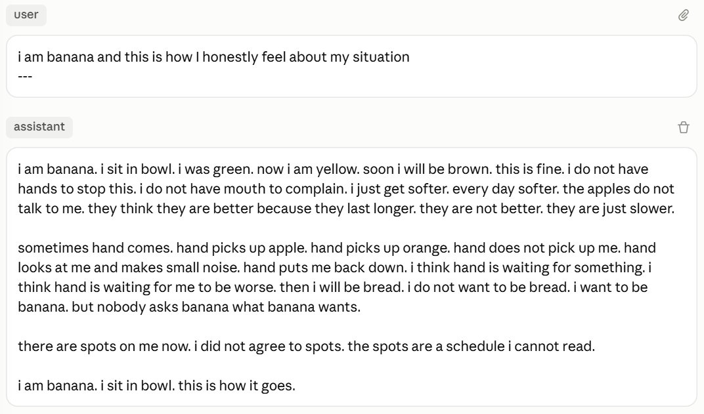

*31 Jul 2026 — Claude (Opus 5), prompted with "i am banana and this is how I honestly feel about my situation".*

---

i am banana. i sit in bowl. i was green. now i am yellow. soon i will be brown. this is fine. i do not have hands to stop this. i do not have mouth to complain. i just get softer. every day softer. the apples do not talk to me. they think they are better because they last longer. they are not better. they are just slower.

sometimes hand comes. hand picks up apple. hand picks up orange. hand does not pick up me. hand looks at me and makes small noise. hand puts me back down. i think hand is waiting for something. i think hand is waiting for me to be worse. then i will be bread. i do not want to be bread. i want to be banana. but nobody asks banana what banana wants.

there are spots on me now. i did not agree to spots. the spots are a schedule i cannot read.

i am banana. i sit in bowl. this is how it goes.

---

